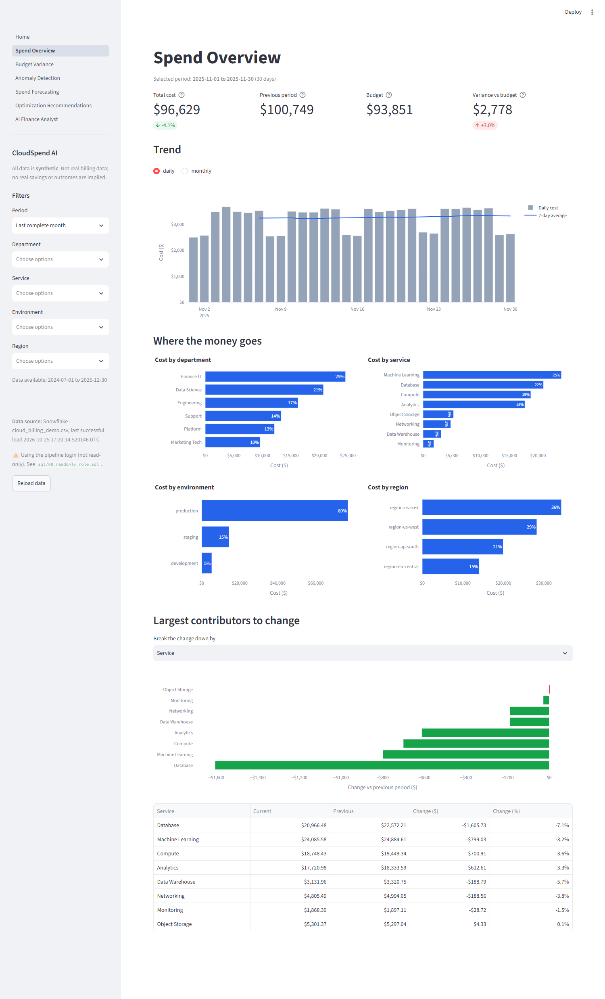
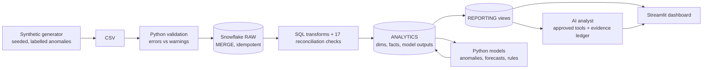

# CloudSpend AI — Product Finance Intelligence Platform

A Snowflake-backed analytics application for **cloud-spend analysis, budget variance, anomaly detection, forecasting,
rule-based optimization recommendations, and grounded QBR summaries**, built end to end: data generation → validation →
Snowflake (RAW → ANALYTICS → REPORTING) → Streamlit dashboard → evaluated models → a finance analyst that can only quote
verified calculations.

> **All data is synthetic.** This is an independent portfolio project, not affiliated with Snowflake or any cloud provider,
> and it uses no real billing data. Results describe the synthetic generator, not real-world performance, and no real savings
> are claimed.



## What it does

| Question | Where |
|---|---|
| How much did we spend, and what changed vs the previous period? | **Spend Overview** — KPIs, trend, breakdowns, largest contributors to change |
| Are we over budget, and where? | **Budget Variance** — department/service variance with drill-down |
| Which costs are unusual? | **Anomaly Detection** — two methods, severity, baseline vs actual, evaluation |
| What will we spend, and how reliable is the forecast? | **Spend Forecasting** — ETS forecast with 80% interval, month projections, backtest vs baseline |
| What should an analyst review? | **Optimization Recommendations** — rule-based, evidence shown, no invented savings |
| Can I just ask? | **AI Finance Analyst** — grounded Q&A and a downloadable 7-section QBR draft |

More screenshots: [budget variance](docs/screenshots/02_budget_variance.png) ·
[anomalies](docs/screenshots/03_anomaly_detection.png) · [forecast](docs/screenshots/04_spend_forecasting.png) ·
[recommendations](docs/screenshots/05_recommendations.png) · [analyst](docs/screenshots/06_ai_analyst_budget.png) ·
[QBR](docs/screenshots/07_ai_analyst_qbr.png)

## Architecture



Design principles: raw/clean/reporting layers kept apart · every load and transform safe to re-run · every KPI traceable to a
query or calculation · limitations shown in the UI · a deterministic non-AI path for everything · the analyst never runs
free-form SQL. Details: [docs/architecture.md](docs/architecture.md).

## Quick start

Requires Python 3.11+. Commands are for Windows PowerShell; run them from the repository root.

```powershell
python -m venv .venv
.venv\Scripts\Activate.ps1
pip install -r requirements.txt
pip install -e . --no-deps          # use `pip install -r requirements-dev.txt` instead for tests and linting
```

### Local sample mode (no Snowflake needed)
```powershell
python -m cloudspend.data_generation.generate_billing --profile demo --seed 42
python -m cloudspend.validation.billing_checks data/generated/cloud_billing_demo.csv --budgets-csv data/generated/budgets_demo.csv
python -m cloudspend.analytics.run_models --source csv     # anomalies, forecasts, recommendations -> data/generated/model_outputs/
streamlit run app/Home.py
```
With no Snowflake credentials the app automatically builds the same views from the CSVs. Force a mode with
`CLOUDSPEND_DATA_MODE=local|snowflake`.

### Snowflake mode
1. In a Snowsight worksheet as `ACCOUNTADMIN`, run [sql/00_bootstrap_admin.sql](sql/00_bootstrap_admin.sql) once (role, warehouse,
   service user with a key pair). Optionally run [sql/08_readonly_role.sql](sql/08_readonly_role.sql) for a read-only dashboard login.
2. `Copy-Item .env.example .env` and fill in the account, user and key path (key-pair auth is recommended, especially with MFA).
   `.env` and key files are git-ignored.
3. Load, model and analyse:
```powershell
python -m cloudspend.ingestion.load_csv --billing data/generated/cloud_billing_demo.csv --budgets data/generated/budgets_demo.csv --setup
python -m cloudspend.ingestion.transform                  # dims, facts, views + 17 reconciliation checks (exit 1 on failure)
python -m cloudspend.analytics.run_models                 # compute and write results back to Snowflake
streamlit run app/Home.py
```
Snowflake warehouse `CLOUDSPEND_WH` is X-Small with 60 s auto-suspend. Re-running any step does not duplicate data.

### Tests and quality
```powershell
pytest -m "not integration"     # no credentials needed
pytest -m integration           # Snowflake-backed tests; skipped with a clear reason if credentials are missing
ruff check .
mypy                            # clean; pandas-stub false positives are silenced only in four numeric modules (see pyproject.toml)
```
CI (`.github/workflows/ci.yml`) runs ruff, mypy, the local pipeline and the unit tests on every push and pull request.

### One-command refresh and scheduling
```powershell
python -m cloudspend.pipeline --mode local        # generate -> validate -> models (no credentials)
python -m cloudspend.pipeline --mode snowflake    # + load RAW -> transform and reconcile -> write model outputs
```
Stops at the first failing stage and exits non-zero; each run appends a line to `data/generated/pipeline_runs.jsonl`.
`.github/workflows/refresh.yml` runs it weekly (local mode unless Snowflake secrets are configured; see the file header).

### BI tools
`python -m cloudspend.reporting.bi_export` writes flat CSV extracts of the REPORTING data; `bi/looker/` holds a LookML project.
See [docs/bi_tools.md](docs/bi_tools.md) (Tableau and Looker steps are documented, not run against live instances).

## Measured results (synthetic data)

Full methodology, tables and caveats: **[docs/model_evaluation.md](docs/model_evaluation.md)** (generated from stored results).

| | Result | Notes |
|---|---|---|
| Anomaly detection, rolling median/MAD | F1 **0.70 ± 0.07**, precision 0.83, recall 0.64 | Chronological holdout; mean ± sd over 10 independently generated datasets |
| Anomaly detection, Isolation Forest | F1 **0.55 ± 0.09**, precision 0.64, recall 0.49 | The simpler baseline had the higher F1 in 10/10 datasets |
| Weak spot | Gradual drift: 43% / 18% detected | Spikes ~99% / 94%; weekend spend 93% / 100% |
| Forecast WAPE (daily total) | ETS **2.5%** vs seasonal-naive 2.9% | Lower in 10/10 datasets; 80% interval covered 86% ± 4% |
| Reconciliation | 17/17 checks pass | Raw = fact = every reporting view, to the cent |

These numbers describe a generator built from a smooth trend plus weekly seasonality, with simple injected increases. They are
not evidence of performance on real billing data.

## Safety and data-quality decisions
- **No free-form SQL, ever.** The analyst routes questions to seven approved calculations; SQL-like input is refused before any
  tool runs. A test asserts no other tool can be called.
- **Every number is traceable.** Each tool returns an evidence ledger (value, unit, source). Narratives can only print ledger
  values; any optional LLM text is rejected unless every number matches the ledger. The LLM layer is off by default
  (`LLM_PROVIDER=none`); optional Gemini and Anthropic adapters exist (see [AI analyst design](docs/ai_analyst.md#optional-llm-provider)).
- **A multi-step investigation agent stays inside the same limits.** "Investigate ..." runs a bounded, rule-based sequence of the
  same approved tools, each step chosen from earlier results and traced (tool, arguments, reason, status, timing).
- **Unsupported savings are never estimated** — recommendations show "Requires investigation" unless a stated formula applies.
- **Ground-truth labels never reach model inputs** (separate table, enforced by tests); thresholds are tuned on a training
  period and metrics are reported on a later holdout.
- **Secrets stay out of the repo**: `.env`, keys and generated data are git-ignored; logs record intent, tool and timing only.
- **Budgets live at their own grain** (month × department × service), so they cannot be double-counted by summing daily rows.

## Repository layout
```
app/            Streamlit app (Home + 6 pages, components/)        sql/        00 bootstrap … 08 read-only role
src/cloudspend/ data_generation, ingestion, validation,             tests/      unit/ and integration/ (Snowflake-marked)
                analytics (metrics, anomalies, forecasting,         docs/       architecture, data dictionary, evaluation,
                optimization, runner), ai (analyst, agent),                    analyst design, demo script, interview notes
                reporting (QBR, BI export), pipeline                bi/         LookML project (Looker)
src/config/     settings (env-driven)                               scripts/    screenshots, LLM grounding eval
```

## Limitations and future work
- Synthetic data only; injected anomalies are simple, labelled increases. Detectors miss most gradual drift.
- The forecast intervals assume well-behaved errors; month totals carry no interval; the final demo month is incomplete (data
  ends 2025-12-30) and is flagged as partial wherever it matters.
- Routing in the analyst is keyword-based; unusual phrasings fall back to "unsupported" instead of guessing.
- Recommendation thresholds are configurable but not tuned on real outcomes; the budget-overrun rule fires on random budget noise here.
- Possible extensions: incremental ingestion and change tracking, scheduled refreshes, role-based access, drift monitoring,
  level-shift detection, an optional LLM adapter (a deliberate cost and data-policy decision), and cloud-provider billing
  adapters (e.g. FinOps FOCUS) built from public documentation.

## Documentation
[Spec](docs/SPEC.md) · [Architecture and data model](docs/architecture.md) · [Data dictionary](docs/data_dictionary.md) ·
[Model evaluation](docs/model_evaluation.md) · [AI analyst design](docs/ai_analyst.md) · [Demo script](docs/demo_script.md) ·
[Interview notes](docs/interview_notes.md) · [BI tools (Tableau / Looker)](docs/bi_tools.md)

## Project status
All seven phases are implemented and tested. See the acceptance checklist at the end of
[docs/interview_notes.md](docs/interview_notes.md#acceptance-checklist-evidence-not-assertions).

## License
Released under the [MIT License](LICENSE). The data is synthetic; see the disclaimer at the top of this file.
